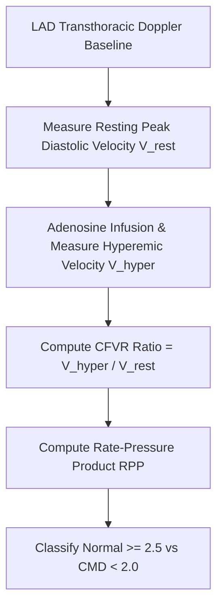

# Cardiac Coronary Flow Velocity Reserve (CFVR) Personal Agent Skill

[](LICENSE)
[](https://www.python.org/)
[]()
[]()
[]()

Deterministic, zero-mock personal agent micro-skill for calculating Coronary Flow Velocity Reserve ($\text{CFVR} = V_{\text{hyper}} / V_{\text{rest}}$) and Rate-Pressure Product (RPP) to diagnose coronary microvascular dysfunction (CMD / INOCA).

## Architecture



## Quickstart

```python
from client import CoronaryFlowVelocityReserveClient

client = CoronaryFlowVelocityReserveClient()
result = client.evaluate_cfvr(
    resting_diastolic_velocity_cm_s=22.0,
    hyperemic_diastolic_velocity_cm_s=68.0,
    resting_heart_rate_bpm=68.0,
    resting_systolic_bp_mmhg=118.0
)
print(result)
```

## License

Apache-2.0
